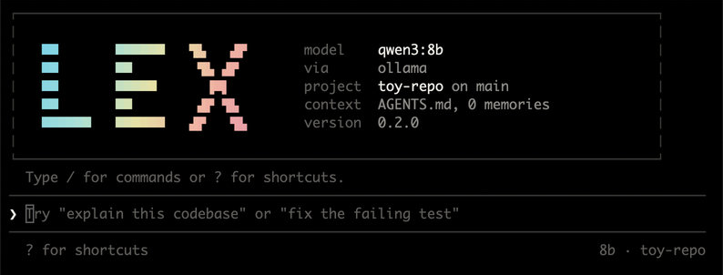

# Lex



Lex is an open-source AI coding agent for your terminal. It reads and edits project files, runs commands with your approval, and streams its work as it goes. Use a hosted model with your own API key or connect to a local model through Ollama or LM Studio.

- **Work interactively or run once.** Use the terminal UI for ongoing work, or pass a prompt on the command line for a single streamed response.
- **Switch models during a task.** The new model takes over at the next agent step and keeps the conversation. Run the same task on several models to compare their results and diffs.
- **Control changes.** Review edits and commands, use plan mode to investigate, and restore project files with `/undo`.
- **Teach Lex your project.** Add repository instructions, save durable facts, and keep reusable workflows in skills.

## Get started

Use Node.js 22 or later to run the bundled CLI, Bun to build it from source, and Git for checkpoints and model comparisons.

```bash
git clone https://github.com/Ankit6055/lex.git
cd lex
bun install
bun run build

node dist/cli.js login
node dist/cli.js --cwd /path/to/project
```

You can also set a provider's environment variable, such as `AI_GATEWAY_API_KEY`, before launching. For local models, start the server and specify a model that supports tool calling.

```bash
node dist/cli.js --cwd /path/to/project --model ollama:qwen3:8b
node dist/cli.js --cwd /path/to/project --readonly "Explain how tests are organized"
```

The examples below use `lex` for the CLI. In a source checkout, substitute `node /path/to/lex/dist/cli.js`. To make `lex` available from any directory, run `npm install -g .` from the built checkout.

## Terminal UI

Run `lex` without a prompt to start an interactive session. The composer supports multiline input, prompt history, file and command completion, and follow-ups queued while the agent works. The transcript shows tool calls and results, and the status area shows elapsed time, output tokens, and generation speed when available.

| Input | What it does |
|---|---|
| `/` | Find slash commands. |
| `@filename` | Complete a project file reference in your prompt. |
| `# fact` | Save a durable fact to project memory. |
| `!command` | Run a shell command yourself. Lex attaches a capped excerpt of its output to your next prompt. |
| `Shift+Tab` | Cycle approval modes. |
| `Ctrl+L` / `Ctrl+P` | Open the model picker / cycle through suggested models. |
| `Ctrl+G` | Edit the current prompt in `$VISUAL` or `$EDITOR`. |
| `Alt+Enter` / backslash then Enter | Start a new line. |
| `Esc` | Interrupt an active turn when the composer menu is closed. |
| `Ctrl+C` / `Ctrl+D` | Clear a draft or interrupt with `Ctrl+C`. At an idle, empty prompt, press `Ctrl+C` twice or `Ctrl+D` once to quit. |
| `?` on an empty prompt | Show shortcuts. |

| Command | What it does |
|---|---|
| `/model [spec]` | Pick or switch models. The conversation stays open and the selection is saved as your default. |
| `/compare [task]` | Pick two or more models and run the same task on each. |
| `/plan`, `/edits`, `/yolo` | Toggle plan, accept-edits, or bypass mode. |
| `/undo` | Restore files from the checkpoint before the most recent recorded turn that changed files. |
| `/clear`, `/new` | Start a fresh conversation. |
| `/memory`, `/remember <fact>` | View or add project memory. |
| `/todo`, `/usage` | Inspect the current checklist or session usage. |
| `/login`, `/help`, `/exit` | Save a provider key, see help, or quit. |

Set `LEX_PLAIN=1` to use the line-based interface. Lex also selects it when input or output is piped. In that interface, `/readonly` toggles read-only mode and `/model` shows a numbered list. Use `NO_COLOR=1` to disable colors. In one-shot mode the response goes to stdout, with tool activity and usage on stderr. Use `lex --help` for flags, including `--cwd`, `--max-steps` (25 by default), and `-m` / `--model`.

## Approvals and undo

| Mode | Agent behavior |
|---|---|
| Ask (default) | Prompts for file changes and shell commands outside the built-in allowlist. Approval can apply once or for the session. |
| Accept edits (`/edits`) | Automatically allows file writes and edits. Shell approvals still apply. |
| Plan (`/plan` or `--readonly`) | Guides the model to investigate and propose changes. The approval gate blocks file writes, edits, and shell commands outside the allowlist. |
| Bypass (`/yolo` or `--yolo`) | Runs agent tools without approval prompts. |

File tools check that paths resolve inside the project root. Shell commands run with your user permissions. The `!` shortcut runs commands you type directly.

Before a turn, Lex can snapshot the project in a private Git repository under `~/.lex/checkpoints/`. `/undo` restores files captured by the checkpoint and removes files added since it. It can also revert manual edits made since that checkpoint. Checkpoints use Git's file selection and work for projects without their own Git repository.

## Compare models

```bash
lex compare --models gateway:anthropic/claude-sonnet-5.5,gateway:openai/gpt-6.2-sol \
  --check 'npm test' --diff "Add input validation to createUser"
```

In a terminal you can omit `--models` to open the picker. Lex runs each model in parallel in a separate temporary Git copy and displays its status, token usage, generation speed when available, estimated cost, and recent tool activity. Press `Esc` to stop the race. Piped runs and `LEX_PLAIN=1` use line-by-line logs.

Use `--check '<command>'` to score the result in each copy. Lex defaults to `npm test` when the project's `package.json` defines a test script. The final report shows check results, the fastest qualifying model, the cheapest qualifying model when pricing is available, and paths to the copies. Failed checks include an output excerpt. Costs are estimates based on AI Gateway catalog prices for supported models.

Use `--diff` to include full diffs. Compare runs agents unattended and links an existing `node_modules` directory from the source project.

## Providers and configuration

Lex supports 19 built-in providers. Use `lex login` to save a key in `~/.lex/auth.json` with owner-only permissions, or set the matching environment variable. Environment keys take precedence.

| Provider ID | API key variable | Provider ID | API key variable |
|---|---|---|---|
| `gateway` | `AI_GATEWAY_API_KEY` | `groq` | `GROQ_API_KEY` |
| `anthropic` | `ANTHROPIC_API_KEY` | `cerebras` | `CEREBRAS_API_KEY` |
| `openai` | `OPENAI_API_KEY` | `together` | `TOGETHER_API_KEY` |
| `openrouter` | `OPENROUTER_API_KEY` | `fireworks` | `FIREWORKS_API_KEY` |
| `google` | `GEMINI_API_KEY` | `moonshot` | `MOONSHOT_API_KEY` |
| `xai` | `XAI_API_KEY` | `zai` | `ZAI_API_KEY` |
| `deepseek` | `DEEPSEEK_API_KEY` | `minimax` | `MINIMAX_API_KEY` |
| `mistral` | `MISTRAL_API_KEY` | `nvidia` | `NVIDIA_API_KEY` |
| `huggingface` | `HF_TOKEN` | `ollama`, `lmstudio` | Local, no key |

Run `lex models` to see available model specs. Use `provider:model` for an exact choice, a provider name such as `deepseek` for its default, or a recognized bare model ID. For example, a bare `claude-*` model uses Anthropic when an Anthropic key is configured and AI Gateway otherwise.

Model selection checks `--model`, then `LEX_MODEL`, then `defaultModel` in `~/.lex/config.json`, followed by the first configured hosted provider. Set `LEX_HOME` to change the directory that holds configuration, credentials, user skills, and checkpoints.

Add a custom OpenAI-compatible endpoint in `~/.lex/config.json`. Set `apiKeyEnv` when the endpoint requires a key. OpenAI-compatible adapters also accept a `<PROVIDER>_BASE_URL` override, such as `OLLAMA_BASE_URL`.

```json
{
  "defaultModel": "vllm:qwen3",
  "providers": {
    "vllm": {
      "baseURL": "http://localhost:8000/v1",
      "models": ["qwen3"]
    }
  }
}
```

## Project context and tools

- **Instructions.** Lex looks for the nearest `AGENTS.md`, `CLAUDE.md`, or `LEX.md` between the working directory and the Git root.
- **Memory.** Project facts live in `.lex/memory.md` and are loaded into future sessions. Use `# fact`, `/remember`, or ask the agent to remember a convention.
- **Skills.** Put a `SKILL.md` with a name, description, and instructions in `skills/<name>/` in the project or under `~/.lex/skills/<name>/`. Lex lists the names and descriptions in the prompt and loads the full instructions on demand. Project skills take precedence when names match.
- **Tools.** The agent can list, search, read, write, and edit files, run shell commands, track todos, and ask questions. The `task` tool delegates exploration to a read-only subagent and can use a cheaper model when one is available.

The [agent loop](src/agent.ts) runs tool calls in order. It turns earlier tool exchanges into short notes and keeps current-turn results until the context budget requires pruning. For implementation details, see the [session](src/session.ts), [terminal UI](src/ui/), and [provider registry](src/providers.ts).

## Develop and verify

```bash
bun install
bun run dev
bun run typecheck
bun test
bun test test/properties.test.ts
bun run build
bash scripts/smoke.sh
bash scripts/smoke.sh --live
```

The default test suite covers unit behavior, CLI and agent integration, regressions, and property tests. Property tests run 500 generated cases per property. Replay a failure with the reported `seed` and `path` in that test's `fc.assert` options. The optional live smoke test uses a configured provider key and verifies a read-only tool round trip from a clean package install.

Try the [toy repository](examples/toy-repo) for a small project with a failing test. The [build plan](plan.md) describes how the core was designed.

[MIT license](LICENSE).
